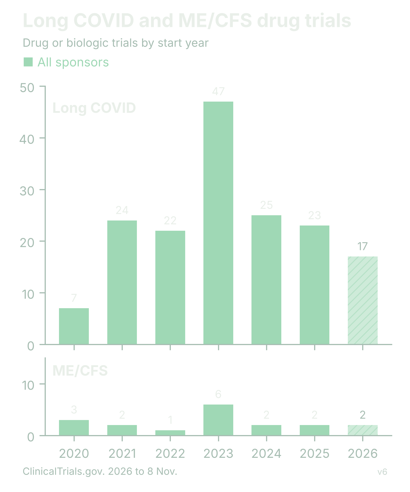
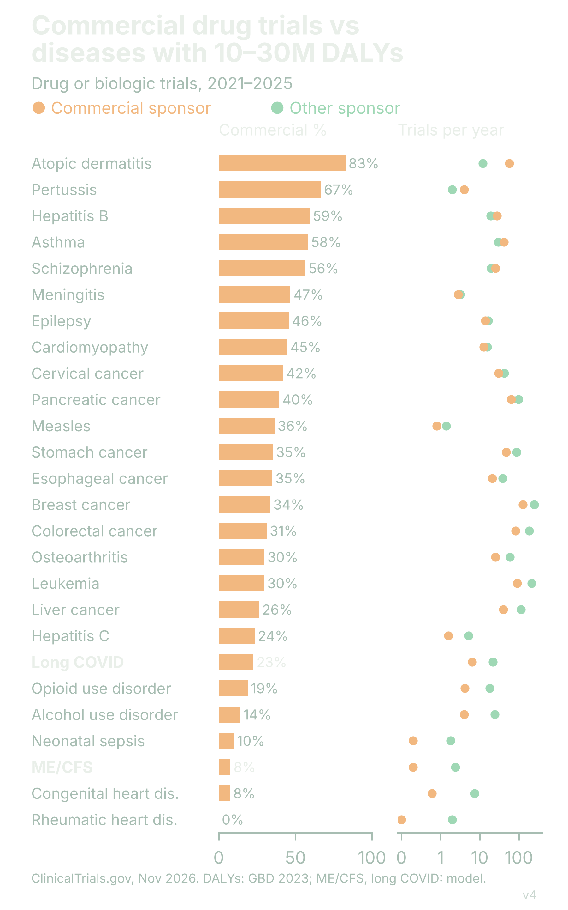
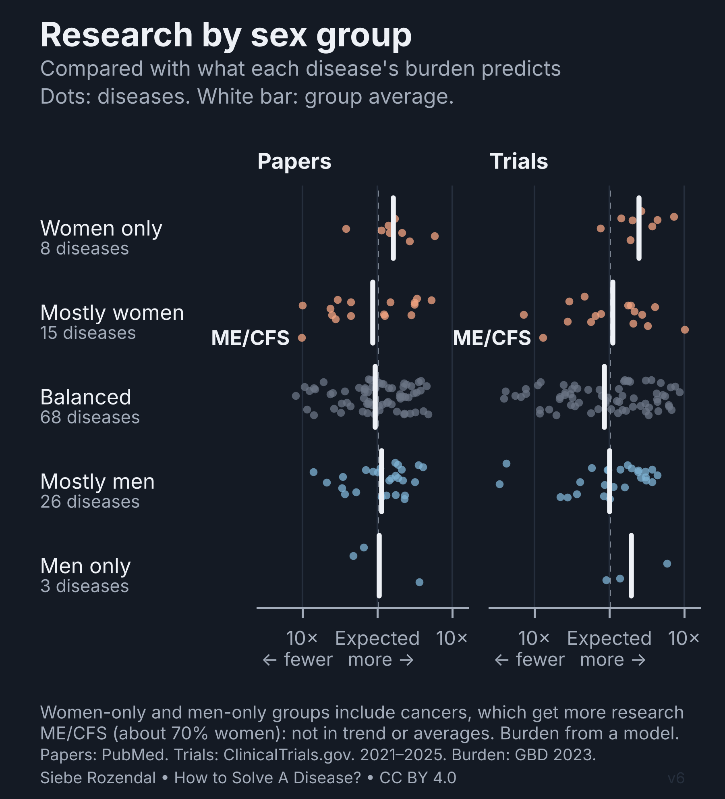

# pais-data

How much research do ME/CFS and long COVID get, compared with other diseases of similar burden?
This repo holds the data pulls, scripts and charts: papers (PubMed), trials (ClinicalTrials.gov and
WHO ICTRP), trial sponsors, and disease burden (GBD 2023 DALYs) for up to 120 comparison diseases.

**Browse everything on one page:** https://ebise-wq.github.io/pais-data/ (every chart and data
file, with short notes and download links). It is served by GitHub Pages from
[`docs/index.html`](docs/index.html) on `main` (Settings → Pages → Deploy from a branch → `main`,
folder `/docs`).

## Folders

| Folder | What is in it |
|---|---|
| [`expanded/`](expanded/) | Main analysis: research vs burden for 120 diseases, with clean-up checks |
| [`expanded/ictrp/`](expanded/ictrp/) | Trials in all registries (WHO ICTRP) vs ClinicalTrials.gov; ME/CFS trial criteria |
| [`sex/`](sex/) | Does research differ by which sex a disease mostly affects? |
| [`analysis/`](analysis/) | First 13-disease comparison, trial sponsor types, long COVID trials over time |
| [`clinicaltrials/`](clinicaltrials/) | ClinicalTrials.gov pulls for 24 diseases, and the sponsor pull |
| [`pubmed/`](pubmed/) | PubMed papers per year for 24 diseases |
| [`gbd/`](gbd/) | GBD 2023 burden files (IHME) |
| [`tools/`](tools/) | `build_catalog.py`, which builds the page in `docs/` and the catalog below |

Each folder has its own README with methods, choices and caveats.

## Running the scripts

Run everything from the repo root, for example `python3 -I expanded/analyse.py`. Scripts need
Python 3 with matplotlib; the `sex/` scripts also need pandas, numpy and statsmodels. Fetch scripts
call the PubMed and ClinicalTrials.gov APIs and keep raw pages in `cache/` folders, which are not
committed. Data files carry the date they were pulled in their name.

## Adding new work

1. Put scripts, data and charts in the folder for that topic (or a new folder with a README).
2. Add each new chart and data file to [`catalog.json`](catalog.json).
3. Run `python3 -I tools/build_catalog.py`. It rebuilds `docs/index.html` and the catalog below, and lists
   any chart or data file that is not in the catalog yet.
4. Merge into `main`. `main` is the only long-lived branch.

## Data terms

Code is GPL-3.0 (see [`LICENSE`](LICENSE)). GBD data: cite as in [`gbd/citation.txt`](gbd/citation.txt).
WHO ICTRP exports: attribute WHO ICTRP, no commercial use.

## Catalog

<!-- catalog:start -->
<!-- Made by tools/build_catalog.py from catalog.json. Do not edit by hand. -->

### Research vs disease burden, 120 diseases

Papers and trials per year (2021–2025) set against global DALYs (GBD 2023) for 120 diseases. ME/CFS has 10.3× fewer papers (90% range 7.5–14.5) and 7.7× fewer trials (5.0–11.7) than the trend predicts for its burden. On papers, only neonatal encephalopathy falls further below. The trend is loose (R² 0.39 for papers, 0.38 for trials).

Page: https://ebise-wq.github.io/pais-data/burden-120.html

| File | What it is | Rows |
|---|---|---|
| [`expanded/burden_interactive_2021-2025.json`](expanded/burden_interactive_2021-2025.json) | Data behind the interactive charts: each disease's shortfall with 90% range and rank, a low-income flag, and the comparator-set table. Computed in a separate session; that code is not in the repo. | 124 |
| [`expanded/burden_vs_research_expanded_2021-2025.csv`](expanded/burden_vs_research_expanded_2021-2025.csv) | One row per disease: DALYs, papers and trials per year (raw and cleaned), trend value and shortfall. | 120 |
| [`expanded/fits_2021-2025.csv`](expanded/fits_2021-2025.csv) | Log-log trend fits for several disease subsets and for the cleaned counts, with the ME/CFS shortfall under each. | 16 |
| [`expanded/counts_2026-11-11.csv`](expanded/counts_2026-11-11.csv) | Raw papers and trials per year, 2021–2025, for the 111 fetched causes. | 111 |
| [`expanded/queries_2026-11-11.csv`](expanded/queries_2026-11-11.csv) | The exact PubMed and ClinicalTrials.gov search for each cause. | 111 |

Notes: [`expanded/README.md`](expanded/README.md)

### Trials in all registries (WHO ICTRP)

ClinicalTrials.gov misses trials registered elsewhere. All registries hold 2.5× as many ME/CFS trials (1.8× without the two Chinese registries), against a median of 1.9× for 18 comparison diseases. Adjusted for this, the ME/CFS trial shortfall is about 6–8×. 29% of ME/CFS trials are not mainly in ME/CFS patients, between MS (17%) and RA (38%).

Page: https://ebise-wq.github.io/pais-data/ictrp.html

| File | What it is | Rows |
|---|---|---|
| [`expanded/ictrp/ictrp_vs_ctgov_2021-2025.csv`](expanded/ictrp/ictrp_vs_ctgov_2021-2025.csv) | Trials per disease in all registries vs ClinicalTrials.gov, 31 diseases. | 31 |
| [`expanded/ictrp/mecfs_trial_criteria.csv`](expanded/ictrp/mecfs_trial_criteria.csv) | Every ME/CFS trial started 2021–2025, classified by diagnostic criteria. Checked by hand. | 114 |
| [`expanded/ictrp/ms_ra_trial_sample.csv`](expanded/ictrp/ms_ra_trial_sample.csv) | Random sample of 60 MS and 60 RA trials, classified by hand for comparison. | 120 |
| [`expanded/ictrp/raw/export*.xml.gz`](expanded/ictrp/raw) | Raw ICTRP XML exports (5 files), downloaded by hand on 19 Nov 2026. WHO ICTRP terms: no commercial use. |  |

Notes: [`expanded/ictrp/README.md`](expanded/ictrp/README.md)

### Long COVID and ME/CFS trials

Long COVID trial starts peaked at 155 in 2023 and fell to 70 in 2025. ME/CFS stayed at 8–12 a year. Drug or biologic trials only: long COVID went from 47 in 2023 to 23 in 2025, and ME/CFS had 1–6 a year. In 2021–2025, 23% of long COVID drug trials had a commercial lead sponsor (32 of 141), and 8% of ME/CFS drug trials (1 of 13), against a median of 35% for 24 diseases with 10–30M DALYs.

Page: https://ebise-wq.github.io/pais-data/trials.html

 

Long COVID and ME/CFS trials per year, by sponsor: [`analysis/sponsor_per_year.png`](analysis/sponsor_per_year.png)

Long COVID and ME/CFS trials per year, all trial types: [`analysis/all_trials_per_year.png`](analysis/all_trials_per_year.png)

| File | What it is | Rows |
|---|---|---|
| [`analysis/sponsor_by_disease_2021-2025.csv`](analysis/sponsor_by_disease_2021-2025.csv) | Per disease: drug trials, commercial count and share, large-pharma-led trials. | 26 |
| [`analysis/sponsor_by_year_2020-2026.csv`](analysis/sponsor_by_year_2020-2026.csv) | Drug trials and commercial trials per disease per start year. | 182 |
| [`clinicaltrials/sponsor_trials_2026-11-25.csv`](clinicaltrials/sponsor_trials_2026-11-25.csv) | One row per drug trial per disease: lead sponsor, sponsor class, phase, title. | 13,865 |

Notes: [`analysis/README.md`](analysis/README.md), [`analysis/sponsor_README.md`](analysis/sponsor_README.md)

### Research by which sex a disease mostly affects

After adjusting for burden, the share of patients who are women shows no detectable link with research volume across 120 diseases: 0.94× papers per +10 percentage points female (95% CI 0.79–1.11) and 0.99× trials (0.81–1.21). The female shares are hand-coded approximations.

Page: https://ebise-wq.github.io/pais-data/sex.html

 

| File | What it is | Rows |
|---|---|---|
| [`sex/sex_by_disease_2021-2025.csv`](sex/sex_by_disease_2021-2025.csv) | Per disease: sex class, female share, DALYs, papers and trials relative to trend. | 120 |
| [`sex/sex_results_2021-2025.csv`](sex/sex_results_2021-2025.csv) | Every regression model, robustness check and sex-class average in one table (column `table` says which). | 70 |

Notes: [`sex/README.md`](sex/README.md)

### Public biomedical R&D funding and output, 2024

Government biomedical R&D budgets set against medical papers and citations, 19 countries. The US spends 32 bn PPS; China's budget is a guess (about 14 bn). Papers grow more slowly than budgets (log-log slope 0.76). Portugal publishes most per unit of budget, Japan and the US least. Seven budgets are estimates, so this is a rough signal, not an efficiency ranking.

Page: https://ebise-wq.github.io/pais-data/funding.html

| File | What it is | Rows |
|---|---|---|
| [`funding/biomedical_rnd_2024.csv`](funding/biomedical_rnd_2024.csv) | One row per country or funder: 2024 budget (reported, estimated or guessed, with range and % of GDP), its split by funding type, medicine papers 1999–2024 and 2024 citations, and how each estimate was built. Compiled in a separate session; that code is not in the repo. | 24 |

Notes: [`funding/README.md`](funding/README.md)

### PAIS burden and ME

An illustrative model of post-acute infection syndromes (PAIS) in the Netherlands. The prevalence figures are guesses based on reading the literature, not hard data. With the default assumptions, ME is about half of PAIS patients (0.52% of 1.06% of the population) but about 80% of the PAIS disease burden, because ME is much more disabling than most PAIS without ME. A second view sketches how Long COVID, ME, dysautonomia and MCAS may overlap. Every input can be changed on the topic page.

Page: https://ebise-wq.github.io/pais-data/pais-burden.html

Notes: [`pais/README.md`](pais/README.md)

### Source data

The first pulls, for 24 diseases: ClinicalTrials.gov trial counts and PubMed paper counts per year, 1996–2026, plus the GBD 2023 burden files. The 120-disease work fetches its own counts (see above).

Page: https://ebise-wq.github.io/pais-data/sources.html

| File | What it is | Rows |
|---|---|---|
| [`clinicaltrials/counts_2026-11-08.csv`](clinicaltrials/counts_2026-11-08.csv) | Study counts for 24 diseases: all studies, trials, randomised, drug, phase and industry-led. | 24 |
| [`clinicaltrials/trials_per_year_2026-11-08.csv`](clinicaltrials/trials_per_year_2026-11-08.csv) | Interventional trials per start year, 1996–2026, for 24 diseases. | 24 |
| [`clinicaltrials/nct_ids_2026-11-08.json`](clinicaltrials/nct_ids_2026-11-08.json) | The trial IDs (NCT numbers) selected for each of the 24 diseases. | 24 |
| [`pubmed/pubs_per_year_long_2026-11-08.csv`](pubmed/pubs_per_year_long_2026-11-08.csv) | Papers per year with the disease in the title, 1996–2026, for 24 diseases, plus publication-date and MeSH counts. | 744 |
| [`pubmed/queries_2026-11-08.csv`](pubmed/queries_2026-11-08.csv) | The exact PubMed search string for each disease. | 24 |
| [`gbd/IHME-GBD_2023_DATA-*.csv`](gbd) | GBD 2023 DALYs, global, both sexes, all ages, level-3 and level-4 causes (2 files). Cite as in gbd/citation.txt. | 5,553 |

Notes: [`clinicaltrials/README.md`](clinicaltrials/README.md), [`pubmed/README.md`](pubmed/README.md), [`gbd/citation.txt`](gbd/citation.txt)
<!-- catalog:end -->
