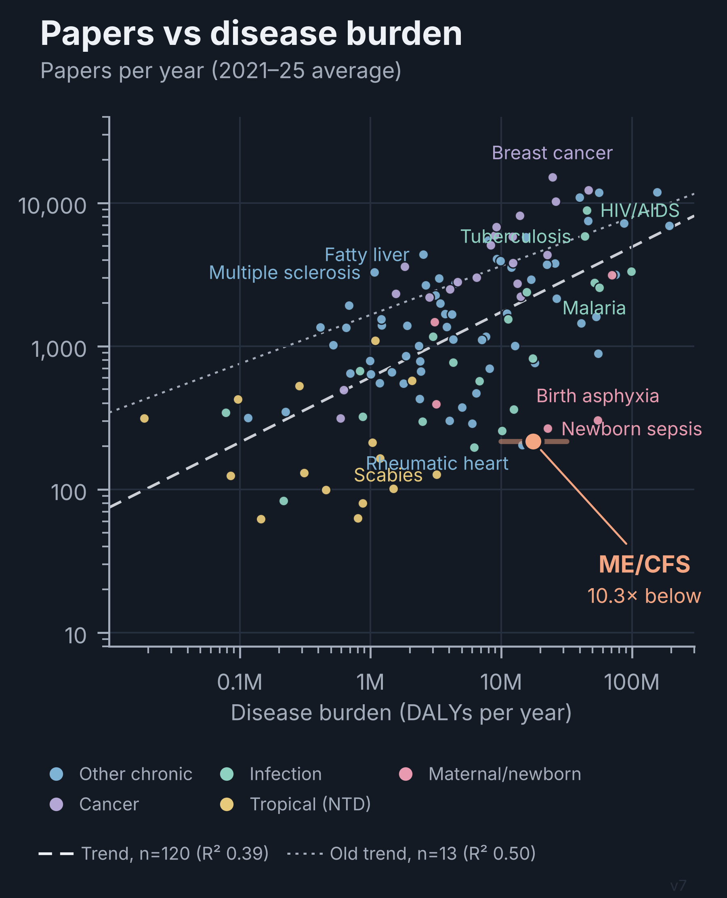
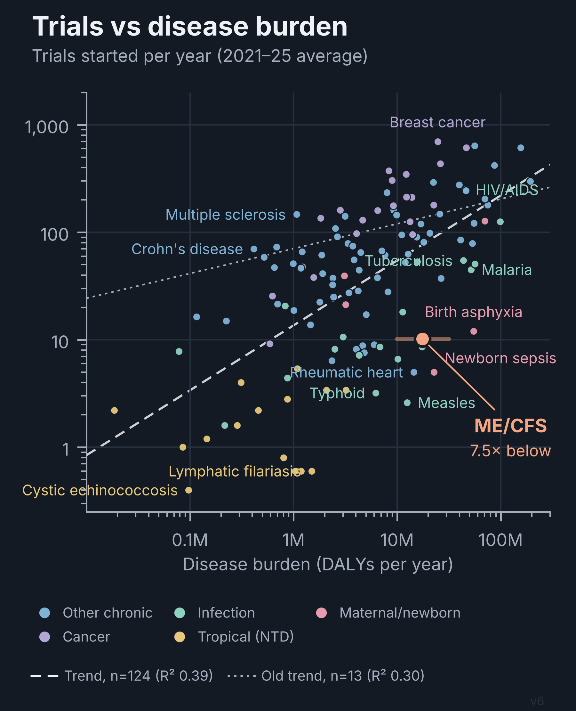
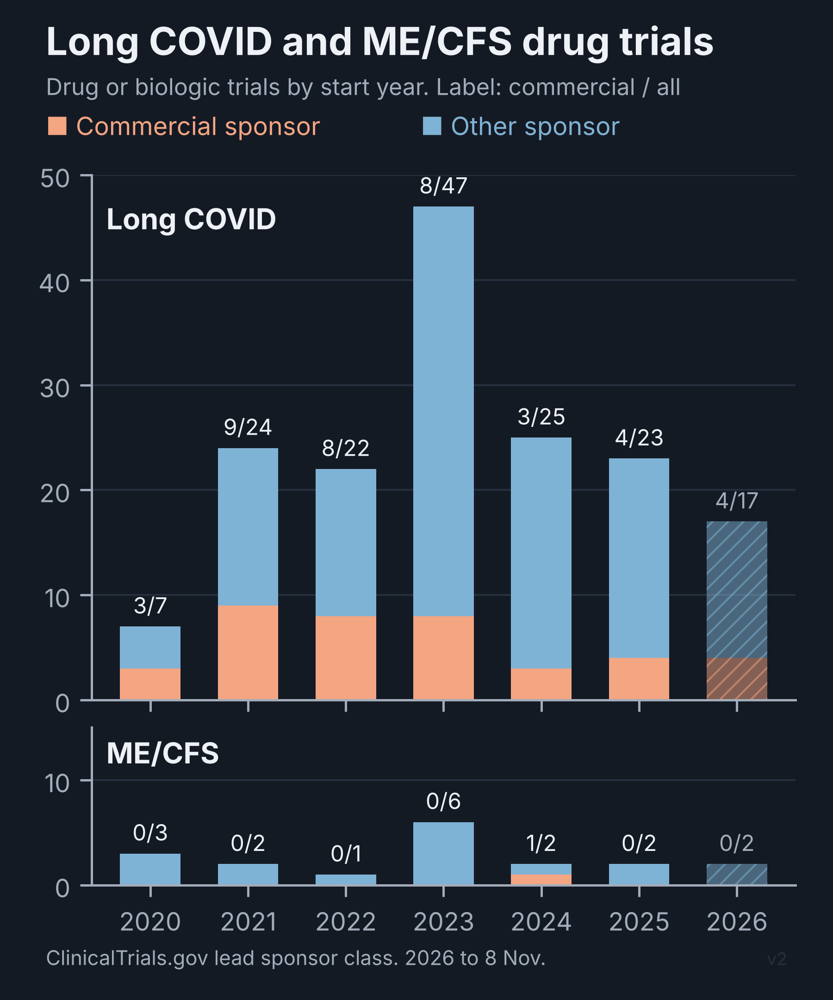
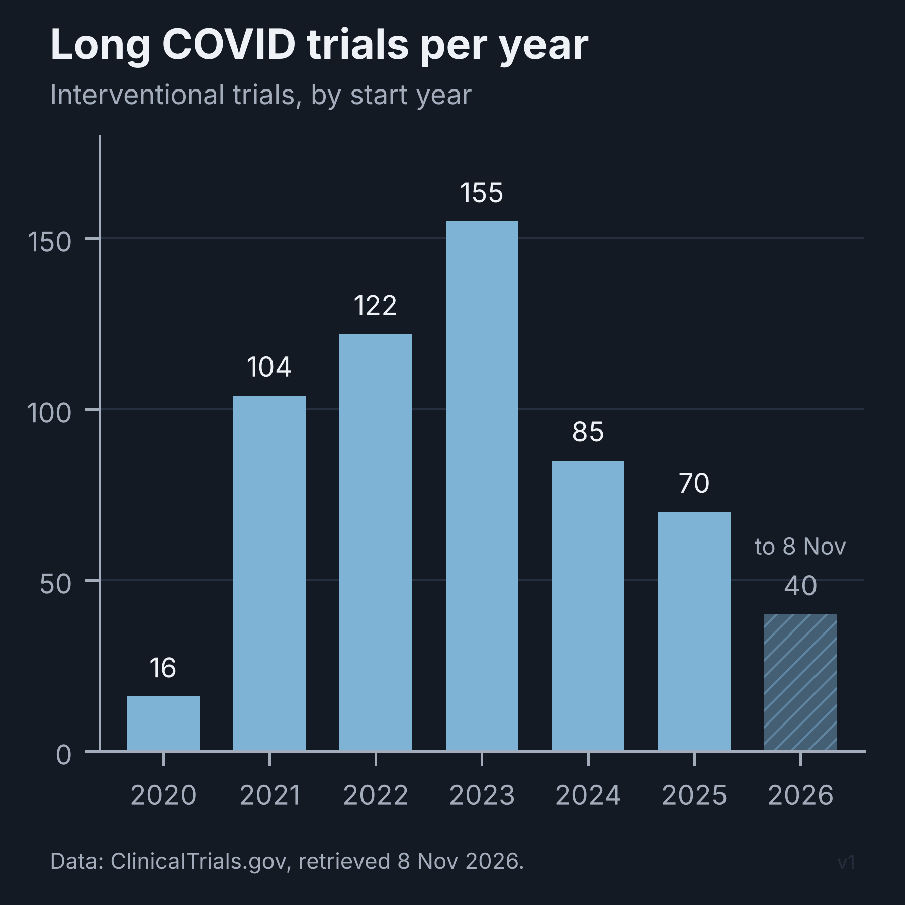
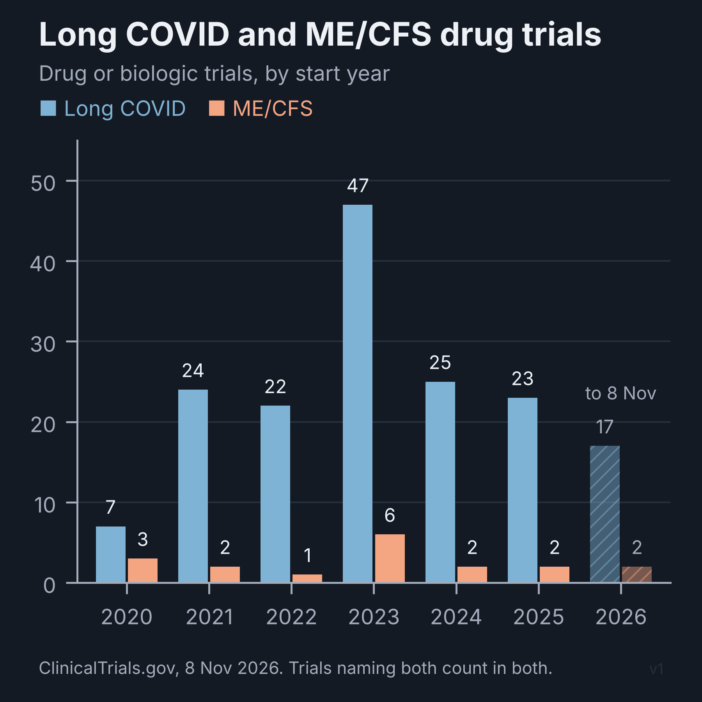
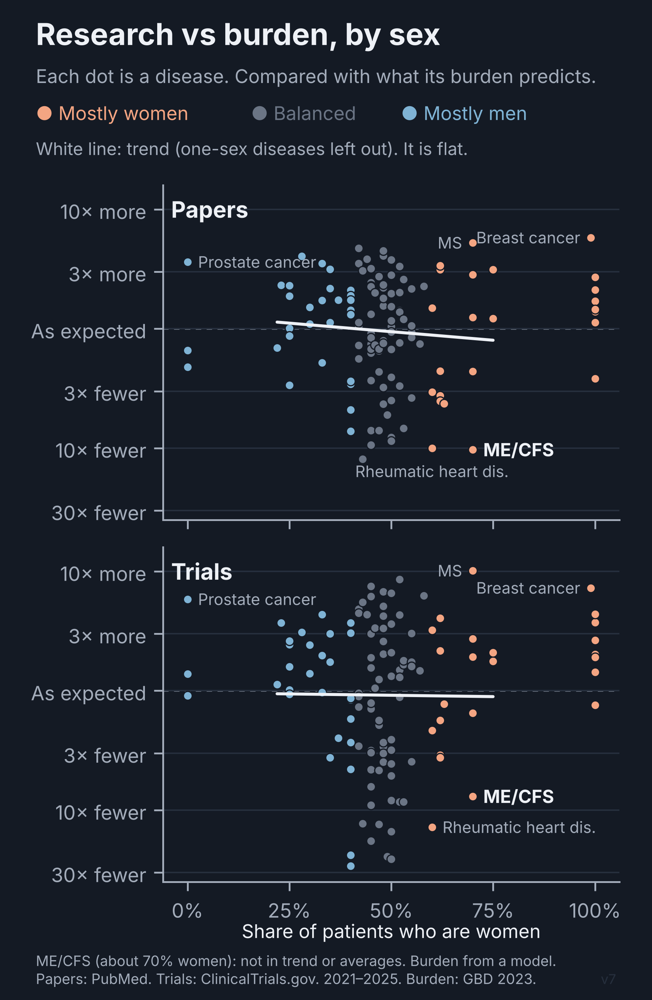
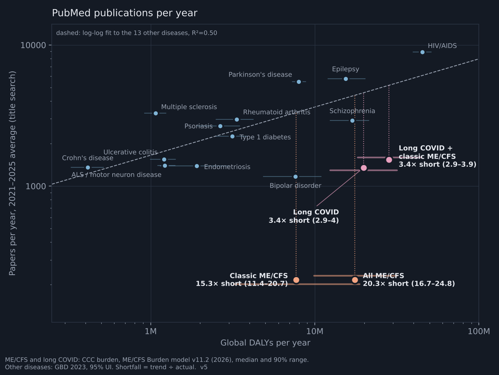
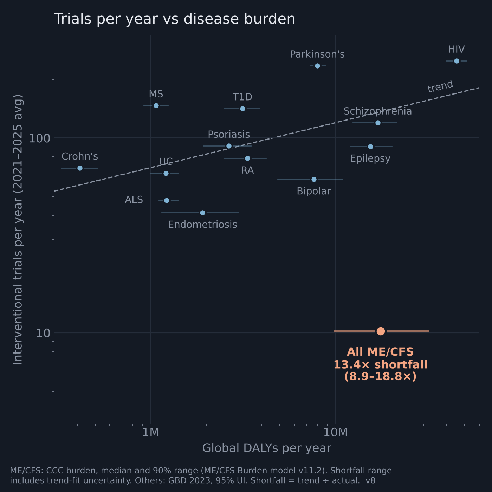

# pais-data

How much research do ME/CFS and long COVID get, compared with other diseases of similar burden?
This repo holds the data pulls, scripts and charts: papers (PubMed), trials (ClinicalTrials.gov and
WHO ICTRP), trial sponsors, and disease burden (GBD 2023 DALYs) for up to 120 comparison diseases.

**Browse everything on one page:** open [`index.html`](index.html) (every chart and data file, with
short notes and download links). To get a public web address for it, turn on GitHub Pages:
Settings → Pages → Deploy from a branch → `main`, folder `/ (root)`. The page will then be at
`https://ebise-wq.github.io/pais-data/`.

## Folders

| Folder | What is in it |
|---|---|
| [`expanded/`](expanded/) | Main analysis: research vs burden for 120 diseases, with clean-up checks |
| [`expanded/ictrp/`](expanded/ictrp/) | Trials in all registries (WHO ICTRP) vs ClinicalTrials.gov; ME/CFS trial criteria |
| [`sex/`](sex/) | Does research differ by which sex a disease mostly affects? |
| [`analysis/`](analysis/) | First 13-disease comparison, trial sponsor types, long COVID trials over time |
| [`clinicaltrials/`](clinicaltrials/) | ClinicalTrials.gov pulls for 24 diseases, and the sponsor pull |
| [`pubmed/`](pubmed/) | PubMed papers per year for 24 diseases |
| [`gbd/`](gbd/) | GBD 2023 burden files (IHME) |
| [`tools/`](tools/) | `build_catalog.py`, which builds `index.html` and the catalog below |

Each folder has its own README with methods, choices and caveats.

## Running the scripts

Run everything from the repo root, for example `python3 -I expanded/analyse.py`. Scripts need
Python 3 with matplotlib; the `sex/` scripts also need pandas, numpy and statsmodels. Fetch scripts
call the PubMed and ClinicalTrials.gov APIs and keep raw pages in `cache/` folders, which are not
committed. Data files carry the date they were pulled in their name.

## Adding new work

1. Put scripts, data and charts in the folder for that topic (or a new folder with a README).
2. Add each new chart and data file to [`catalog.json`](catalog.json).
3. Run `python3 -I tools/build_catalog.py`. It rebuilds `index.html` and the catalog below, and lists
   any chart or data file that is not in the catalog yet.
4. Merge into `main`. `main` is the only long-lived branch.

## Data terms

Code is GPL-3.0 (see [`LICENSE`](LICENSE)). GBD data: cite as in [`gbd/citation.txt`](gbd/citation.txt).
WHO ICTRP exports: attribute WHO ICTRP, no commercial use.

## Catalog

<!-- catalog:start -->
<!-- Made by tools/build_catalog.py from catalog.json. Do not edit by hand. -->

### Research vs disease burden, 120 diseases

Papers and trials per year (2021–2025) set against global DALYs (GBD 2023) for 120 diseases. ME/CFS has 10.3× fewer papers (90% range 7.5–14.5) and 7.7× fewer trials (5.0–11.7) than the trend predicts for its burden. On papers, only neonatal encephalopathy falls further below. The trend is loose (R² 0.39 for papers, 0.38 for trials).

 

| File | What it is | Rows |
|---|---|---|
| [`expanded/burden_vs_research_expanded_2021-2025.csv`](expanded/burden_vs_research_expanded_2021-2025.csv) | One row per disease: DALYs, papers and trials per year, trend value and shortfall. | 120 |
| [`expanded/fits_2021-2025.csv`](expanded/fits_2021-2025.csv) | Log-log trend fits for four disease subsets, with the ME/CFS shortfall under each. | 14 |
| [`expanded/counts_2026-11-11.csv`](expanded/counts_2026-11-11.csv) | Raw papers and trials per year, 2021–2025, for the 111 fetched causes. | 111 |
| [`expanded/queries_2026-11-11.csv`](expanded/queries_2026-11-11.csv) | The exact PubMed and ClinicalTrials.gov search for each cause. | 111 |
| [`expanded/papers_cleaned_2021-2025.csv`](expanded/papers_cleaned_2021-2025.csv) | Paper counts after removing veterinary papers and false abbreviation matches. | 125 |
| [`expanded/trials_title_filtered_2021-2025.csv`](expanded/trials_title_filtered_2021-2025.csv) | Trial counts weighted by how closely each trial matches the disease. | 125 |
| [`expanded/sensitivity_cleaned_2021-2025.csv`](expanded/sensitivity_cleaned_2021-2025.csv) | Trend refitted on the cleaned counts. ME/CFS barely moves (10.2× papers, 7.5× trials). | 4 |

Notes: [`expanded/README.md`](expanded/README.md)

### Trials in all registries (WHO ICTRP)

ClinicalTrials.gov misses trials registered elsewhere. All registries hold 2.5× as many ME/CFS trials (1.8× without the two Chinese registries), against a median of 1.9× for 18 comparison diseases. Adjusted for this, the ME/CFS trial shortfall is about 6–8×. 29% of ME/CFS trials are not mainly in ME/CFS patients, between MS (17%) and RA (38%).

| File | What it is | Rows |
|---|---|---|
| [`expanded/ictrp/ictrp_vs_ctgov_2021-2025.csv`](expanded/ictrp/ictrp_vs_ctgov_2021-2025.csv) | Trials per disease in all registries vs ClinicalTrials.gov, 31 diseases. | 31 |
| [`expanded/ictrp/mecfs_shortfall_adjusted.csv`](expanded/ictrp/mecfs_shortfall_adjusted.csv) | ME/CFS trial shortfall rescaled for trials in other registries. | 4 |
| [`expanded/ictrp/mecfs_trial_criteria.csv`](expanded/ictrp/mecfs_trial_criteria.csv) | Every ME/CFS trial started 2021–2025, classified by diagnostic criteria. Checked by hand. | 114 |
| [`expanded/ictrp/ms_ra_trial_sample.csv`](expanded/ictrp/ms_ra_trial_sample.csv) | Random sample of 60 MS and 60 RA trials, classified by hand for comparison. | 120 |
| [`expanded/ictrp/search_strings.txt`](expanded/ictrp/search_strings.txt) | The five ICTRP condition searches. |  |
| [`expanded/ictrp/raw/export*.xml.gz`](expanded/ictrp/raw) | Raw ICTRP XML exports (5 files), downloaded by hand on 19 Nov 2026. WHO ICTRP terms: no commercial use. |  |

Notes: [`expanded/ictrp/README.md`](expanded/ictrp/README.md)

### Drug trials by sponsor type

In 2021–2025, 23% of long COVID drug trials had a commercial lead sponsor (32 of 141), and 8% of ME/CFS drug trials (1 of 13). The median across 24 diseases with 10–30M DALYs was 35%. No long COVID drug trial was led by a large drug company.

 

| File | What it is | Rows |
|---|---|---|
| [`analysis/sponsor_by_disease_2021-2025.csv`](analysis/sponsor_by_disease_2021-2025.csv) | Per disease: drug trials, commercial count and share, large-pharma-led trials. | 26 |
| [`analysis/sponsor_by_year_2020-2026.csv`](analysis/sponsor_by_year_2020-2026.csv) | Drug trials and commercial trials per disease per start year. | 182 |
| [`clinicaltrials/sponsor_trials_2026-11-25.csv`](clinicaltrials/sponsor_trials_2026-11-25.csv) | One row per drug trial per disease: lead sponsor, sponsor class, phase, title. | 13,865 |

Notes: [`analysis/sponsor_README.md`](analysis/sponsor_README.md)

### Long COVID and ME/CFS trials over time

Long COVID interventional trial starts peaked at 155 in 2023 and fell to 70 in 2025. ME/CFS stayed at 8–12 a year. For drug or biologic trials only: long COVID went from 47 in 2023 to 23 in 2025, and ME/CFS had 1–6 a year.

 

| File | What it is | Rows |
|---|---|---|
| [`clinicaltrials/drug_trials_per_year_2026-11-11.csv`](clinicaltrials/drug_trials_per_year_2026-11-11.csv) | Drug or biologic trials per start year, 2015–2026, for long COVID and ME/CFS. | 2 |

Notes: [`analysis/README.md`](analysis/README.md)

### Research by which sex a disease mostly affects

After adjusting for burden, the share of patients who are women shows no detectable link with research volume across 120 diseases: 0.94× papers per +10 percentage points female (95% CI 0.79–1.11) and 0.99× trials (0.81–1.21). The female shares are hand-coded approximations.

 

| File | What it is | Rows |
|---|---|---|
| [`sex/sex_labels.csv`](sex/sex_labels.csv) | Female share of patients per disease, with confidence and basis. Coded by hand. | 120 |
| [`sex/sex_by_disease_2021-2025.csv`](sex/sex_by_disease_2021-2025.csv) | Per disease: sex class, female share, DALYs, papers and trials relative to trend. | 120 |
| [`sex/sex_models_2021-2025.csv`](sex/sex_models_2021-2025.csv) | All regression models: multiplier per +10 pp female, CI, p and permutation p. | 28 |
| [`sex/sex_robustness_2021-2025.csv`](sex/sex_robustness_2021-2025.csv) | Robustness checks: cleaned counts, dropped groups, label noise and more. | 32 |
| [`sex/sex_class_summary_2021-2025.csv`](sex/sex_class_summary_2021-2025.csv) | Average papers and trials vs trend for each of the five sex classes. | 5 |

Notes: [`sex/README.md`](sex/README.md)

### Research vs disease burden, first 13 diseases

The first comparison used 13 well-funded chronic diseases. Against them ME/CFS had 20.3× fewer papers (90% range 12.5–30.6) and 13.4× fewer trials (8.9–18.8). These 13 sit above the broader trend, so they set a high bar. The 120-disease version gives about half these multiples.

 

| File | What it is | Rows |
|---|---|---|
| [`analysis/plot_data_2021-2025.csv`](analysis/plot_data_2021-2025.csv) | Data behind the two scatterplots, with trend values and shortfalls. Data dictionary: analysis/plot_data_README.md. | 17 |
| [`analysis/shortfall_ccc_2021-2025.csv`](analysis/shortfall_ccc_2021-2025.csv) | Shortfall for four ways of grouping ME/CFS and long COVID, with 90% ranges. | 8 |

Notes: [`analysis/README.md`](analysis/README.md)

### Source data

The first pulls, for 24 diseases: ClinicalTrials.gov trial counts and PubMed paper counts per year, 1996–2026, plus the GBD 2023 burden files. The 120-disease work fetches its own counts (see above).

| File | What it is | Rows |
|---|---|---|
| [`clinicaltrials/counts_2026-11-08.csv`](clinicaltrials/counts_2026-11-08.csv) | Study counts for 24 diseases: all studies, trials, randomised, drug, phase and industry-led. | 24 |
| [`clinicaltrials/trials_per_year_2026-11-08.csv`](clinicaltrials/trials_per_year_2026-11-08.csv) | Interventional trials per start year, 1996–2026, for 24 diseases. | 24 |
| [`clinicaltrials/nct_ids_2026-11-08.json`](clinicaltrials/nct_ids_2026-11-08.json) | The trial IDs (NCT numbers) selected for each of the 24 diseases. | 24 |
| [`pubmed/pubs_per_year_2026-11-08.csv`](pubmed/pubs_per_year_2026-11-08.csv) | Papers per year with the disease in the title, 1996–2026, for 24 diseases. One column per year. | 24 |
| [`pubmed/pubs_per_year_long_2026-11-08.csv`](pubmed/pubs_per_year_long_2026-11-08.csv) | The same papers per year in long format, plus publication-date and MeSH counts. | 744 |
| [`pubmed/queries_2026-11-08.csv`](pubmed/queries_2026-11-08.csv) | The exact PubMed search string for each disease. | 24 |
| [`gbd/IHME-GBD_2023_DATA-*.csv`](gbd) | GBD 2023 DALYs, global, both sexes, all ages, level-3 and level-4 causes (2 files). Cite as in gbd/citation.txt. | 5,553 |

Notes: [`clinicaltrials/README.md`](clinicaltrials/README.md), [`pubmed/README.md`](pubmed/README.md), [`gbd/citation.txt`](gbd/citation.txt)
<!-- catalog:end -->
